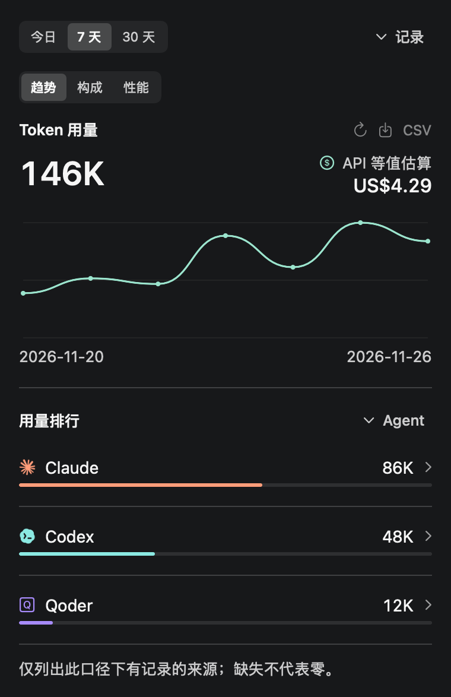

# v4 用量分析预览

参考 [cclank/tokei](https://github.com/cclank/tokei) 从客户端原始记录还原计量的思路。AgentDeck 保留既有的五种 Agent，不把客户端、账户或模型当成新的 Agent，也不把独立的 Gemini CLI 当作 Antigravity。

| Agent | 数据与边界 |
| --- | --- |
| Claude Code | 从会话和子 Agent 的 JSONL 读取有计量信息的响应；区分输入、输出、缓存读写。 |
| Codex | 从 rollout 的用量事件还原增量；一次增量不一定是一次请求。推理 token 属于输出的子集。 |
| Qoder | 国际版桌面数据库与 CLI 会话是不同来源；不能证明可相加的计量不当作准确总量。 |
| Qoder CN | 只读取 CN 自己的 CLI 来源，不挪用国际版的数据。 |
| Antigravity | 桌面和 CLI 的生成记录归同一 Agent；CLI 状态栏采样另列，不叠加到生成记录。 |

## 如何看数字

- 用量页在「趋势」「构成」「性能」间切换时保留时段与口径。「趋势」显示总量和排行；点排行进入该组的详情，返回后保留原列表。也可直接从项目和会话进入各自的统计范围。
- [构成](screenshots/v4-composition-zh.png)分别展示未缓存输入、缓存读取、缓存写入和输出；[性能](screenshots/v4-performance-zh.png)展示调用、延迟和输出速度，不需要展开明细。
- “记录”和“采样”是不同口径。记录中缺少指标不代表实际用量为零；已知小计也不等于完整总量。
- 趋势图只连接相邻且有完整记录的日期；已知零值在基线上，只有部分计量的日期用空心点表示已知小计。缺记录的日期标在图下，不补零。
- 性能页只列有测量值的指标；没有任何性能记录时显示一条提示，不把零个样本解释为零延迟或零速度。
- 调用数、耗时、首 token 延迟及生成速度仅在来源提供足够证据时展示。历史上没有记录的数据无法补测。
- 输出速度参考 [Tokei 的采集器](https://github.com/cclank/tokei/blob/main/usage.30s.py)：把有效样本的输出 token 相加，再除以这些样本的总生成秒数，不对各次 tok/s 取算术平均。有首个输出时间时排除首字等待；只能验证请求起止时，标注「含首字等待样本」。不到 20 个输出 token、时长不在 (0.2, 1800] 秒或超过 3000 tok/s 的样本不参与速率，但不扣减用量。面板展示的是所选时段内已落盘样本的速率，打开性能页会自动刷新，并非服务端逐 token 推送。
- 实际费用与 [API 等价值](v4-pricing.md) 分开；等价值不是订阅账单或充值余额。
- 概览的今日总量和「用量 → 趋势 → 今天」使用相同的可见 Agent、记录口径和本地时区。24 小时分 Agent 曲线是滚动时段，不等同于自然日总量。
- 会话和项目里的「查看用量」进入同一用量页，并保留来源范围。点返回回到原列表；直接点主导航「用量」则看全局统计。

## 本机验收

1. 启动后打开用量页。首次需要在后台建立 SQLite 索引，页面可以先显示部分数据；关闭面板不应中断采集。
2. 切换时间、计量口径与分组，在用量页导出 CSV，与相同筛选条件下的表格比较。导出时若数据已更新，刷新后再试。
3. 从一个有计量记录的项目和会话进入分析，检查范围是否正确。没有原始计量记录的会话不应凭空出现费用或调用数。
4. 本机网关的 `/api/health` 返回 `analytics.status`、扫描计数与错误计数，诊断索引状态不需要打开原始对话日志。

可运行 `python3 scripts/verify-v4-local.py` 验证安装版本、索引就绪状态，以及记录和采样两种口径的 JSON/CSV 一致性。脚本只访问回环地址，不输出会话或项目数据。

索引独立于既有会话索引，查询和导出不会触发同步扫盘。分析不需要额外登录，也不向外部服务上传会话。
